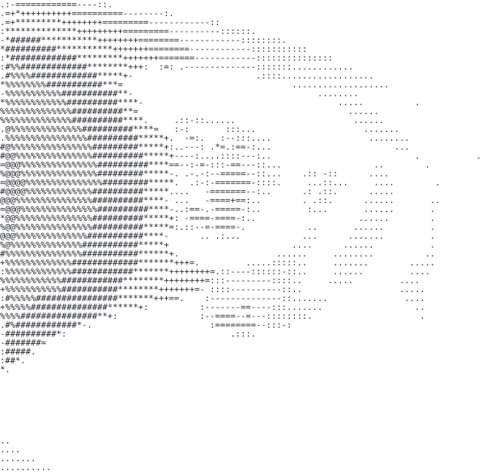

<h3>About Me</h3>

I'm a Cloud & DevOps engineer who learns by building. I work on CI/CD pipelines, infrastructure automation and cloud platforms, and I like turning real operational problems into automated, repeatable, secure systems using modern cloud tooling.

<h3>What I Work On</h3>

- **CI/CD automation:** Jenkins and GitHub Actions pipelines with built-in code-quality and vulnerability scanning (SonarQube, Trivy).
- **Infrastructure as Code:** provisioning with Terraform and policy checks with Checkov.
- **Containers and orchestration:** Docker and Kubernetes.
- **Security and networking:** secrets with Vault, Cloudflare WAF, Nginx and Apache, traffic analysis with Nmap and Wireshark.

 

---

Open to opportunities and collaboration. Reach me on <a href="https://linkedin.com/in/shelkeaditya">LinkedIn</a> or at <a href="mailto:work.shelkeaditya@gmail.com">work.shelkeaditya@gmail.com</a>.

